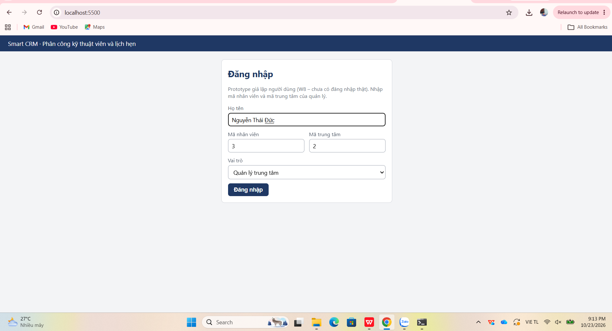
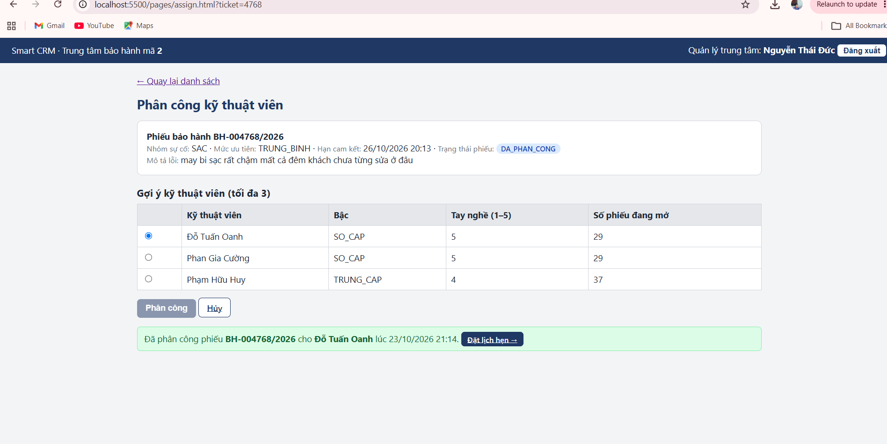
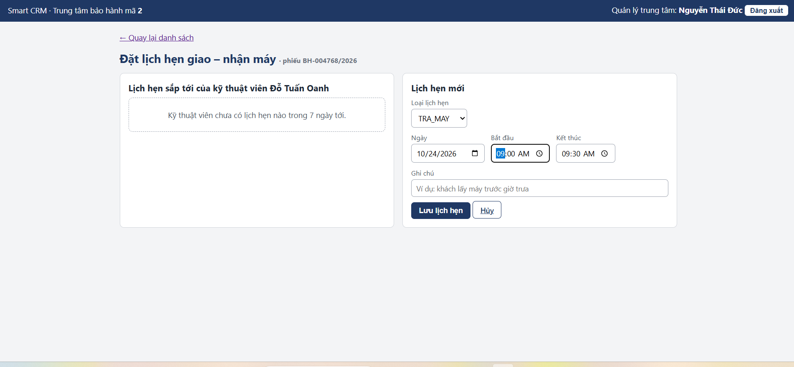

TRƯỜNG ĐẠI HỌC VĂN LANG · KHOA CÔNG NGHỆ THÔNG TIN

Chuyên đề Tốt nghiệp 1 · Lớp 261_71ITGR40203_05

# Báo cáo tiến độ buổi 10 – Sprint 2

*Module mở rộng và Giao diện · Luồng L4 – Phân công kỹ thuật viên và
lịch hẹn · Track SE · Nguyễn Thái Đức – 2374802010117*

## 1. Tóm tắt tiến độ

Đến ngày **23/10/2026**, luồng chính của L4 đã chạy **end-to-end trên dữ
liệu thật** của bộ Dataset Smart CRM (7.800 phiếu, 38 kỹ thuật viên, 6
trung tâm): đăng nhập → **M1** danh sách phiếu chờ phân công → **M2**
gợi ý và phân công kỹ thuật viên → **M3** đặt lịch hẹn giao – nhận máy,
có chặn trùng lịch. Module mở rộng của track SE (giao diện 3 màn hình
gọi API thật) và module Lịch hẹn (E4, E5) đã hiện thực theo đúng kiến
trúc 4 lớp của BT1. Bộ kiểm thử có **21 test PASS**, gồm 2 test giảng
viên gợi ý sau BT1 (TC07 – NFR3 và TC10 – ràng buộc EXCLUDE). README mục
3 đã được **thử trên một thư mục clone mới** và chạy đúng.

## 2. Checklist 10 mục Buổi 10

| **\#** | **Mục kiểm chứng**                                    | **Em đã làm / minh chứng**                                                                                                                                                            | **TT** |
|--------|-------------------------------------------------------|---------------------------------------------------------------------------------------------------------------------------------------------------------------------------------------|--------|
| 1      | Module mở rộng theo track đã hiện thực và chạy được   | Giao diện 3 màn hình M1–M3 gọi API thật; api/client.js là nơi duy nhất gọi fetch, mỗi nghiệp vụ một file \*.api.js; backend thêm E2, E4, E5                                           | Đạt    |
| 2      | Luồng chính chạy END-TO-END không lỗi treo            | Đăng nhập → M1 → M2 phân công → M3 đặt lịch hẹn (Hình 1–3)                                                                                                                            | Đạt    |
| 3      | Chạy trên dữ liệu mẫu THẬT                            | seed_dataset.py nạp Dataset Smart CRM: 7.800 phiếu, 38 KTV, 159 dòng tay nghề, 6 nhóm sự cố, 0 dòng bị loại (mục 4.1)                                                                 | Đạt    |
| 4      | Đã chụp ảnh kết quả toàn luồng, lưu vào docs/         | docs/screenshots/buoi10-m1.png, buoi10-m2.png, buoi10-m3.png                                                                                                                          | Đạt    |
| 5      | ≥ 5 unit test PASS; lệnh chạy test hiện số test       | python -m pytest -v → **21 passed** (mục 4.2)                                                                                                                                         | Đạt    |
| 6      | Có ≥ 1 test cho trường hợp BIÊN hoặc ngoại lệ         | Biên 15/14 phút, 120/121 phút, 08:00, 18:00, lịch sát nhau; ngoại lệ trùng 09:15–09:45 với 09:00–09:30, phiếu chưa có KTV, Chủ nhật                                                   | Đạt    |
| 7      | Ba trạng thái (đang tải, rỗng, lỗi) cho ≥ 1 màn hình  | Thành phần components/data-state.js bọc cả 3 màn hình; trạng thái rỗng thấy ở Hình 3 ("Kỹ thuật viên chưa có lịch hẹn nào trong 7 ngày tới"); tắt backend thì hiện lỗi có nút Thử lại | Đạt    |
| 8      | README mục 3 đủ các bước, mỗi bước một lệnh           | README mục 3: 10 bước, mỗi bước một lệnh, có cột kết quả mong đợi                                                                                                                     | Đạt    |
| 9      | ĐÃ THỬ clone repo vào thư mục mới và chạy theo README | Clone vào Desktop\clone-thu, làm đúng README: cài thư viện, migration, nạp dataset, 21 passed (mục 4.3)                                                                               | Đạt    |
| 10     | Commit đúng quy ước; tổng số commit ≥ 8               | Buổi 10 thêm 4 commit (b8a6e91, ead96d5, 420117a, f50cef7); tổng số commit của repo \> 8                                                                                              | Đạt    |

## 3. Bảng kiểm hạng mục đã hoàn thành

| **Hạng mục**                                     | **Chi tiết**                                                                                                                                                                | **TT**                |
|--------------------------------------------------|-----------------------------------------------------------------------------------------------------------------------------------------------------------------------------|-----------------------|
| E2 – Gợi ý kỹ thuật viên                         | Tối đa 3 KTV cùng trung tâm, tay nghề ≥ 3 (QT-08), sắp theo số phiếu đang mở rồi tay nghề; lọc và đếm trong CSDL (lập luận kiến trúc số 3)                                  | **Hoàn thành**        |
| E4, E5 – Lịch hẹn                                | Lịch hẹn của KTV trong 7 ngày; tạo lịch hẹn kiểm QT-L4-03 (15–120 phút, 08:00–18:00, thứ Hai–thứ Bảy), QT-L4-04, chặn trùng QT-L4-02 ở lớp nghiệp vụ và bằng EXCLUDE ở CSDL | **Hoàn thành**        |
| Giao diện M1, M2, M3                             | Theo wireframe BT1; hiển thị đúng thông báo cho các luồng ngoại lệ UC2 (3a, 5a, 5b, 6a) và UC4 (1a, 4a, 5a)                                                                 | **Hoàn thành**        |
| Đăng nhập, xử lý 401                             | Đăng nhập giả lập (W8); nhận 401 thì xoá người dùng đã lưu và về trang đăng nhập                                                                                            | **Hoàn thành**        |
| Giao diện chạy riêng, CORS                       | Giao diện cổng 5500, backend cổng 3000, backend bật CORS (TD-11)                                                                                                            | **Hoàn thành**        |
| Nạp Dataset Smart CRM                            | Dùng đúng mã gốc của dataset (issue_categories.csv, service_centers.csv – TD-12); chọn 5 phiếu gần nhất mỗi trung tâm đặt lại MOI để mô phỏng phiếu mới (TD-10)             | **Hoàn thành**        |
| Kiểm thử                                         | 12 test lịch hẹn + 6 test phân công + 3 test tích hợp trên database riêng smartcrm_test                                                                                     | **Hoàn thành**        |
| Tài liệu                                         | README mục 3–6, docs/thay-doi-thiet-ke.md TD-07 … TD-12, API contract cập nhật E2, E4                                                                                       | **Hoàn thành**        |
| E6 đổi KTV, E7 phiếu của KTV, E8 khối lượng việc | Mức SHOULD, ngoài luồng chính – thu hẹp phạm vi có ghi nhận (TD-09)                                                                                                         | Hoãn (TD-09)          |
| Docker, PDF báo cáo BT2, tag v0.2                | Theo kế hoạch buổi 11 – 12                                                                                                                                                  | Chưa làm (buổi 11–12) |

## 4. Cách chạy và kết quả

- **Backend:** uvicorn src.backend.main:app --port 3000

- **Giao diện (cửa sổ khác):** python -m http.server 5500 -d
  src/frontend → mở http://localhost:5500

**Hình ảnh chạy luồng chính trên máy (23/10/2026, dữ liệu thật, trung
tâm 2 – TTBH Quận Tân Bình):**

*Hình 1 – Trang đăng nhập (quản lý trung tâm, mã trung tâm 2)*

*Hình 2 – M2: gợi ý 3 kỹ thuật viên cho phiếu BH-004768/2026 (SAC) và
phân công thành công cho Đỗ Tuấn Oanh*

*Hình 3 – M3: đặt lịch hẹn cho kỹ thuật viên đang giữ phiếu; lịch trống
hiển thị trạng thái "rỗng" của DataState*

*Ở Hình 2, cột "Số phiếu đang mở" (29, 29, 37) là khối lượng việc thật
tính từ dữ liệu lịch sử; hai kỹ thuật viên đầu cùng 29 phiếu, cùng tay
nghề 5 nên sắp theo mã kỹ thuật viên – đúng quy tắc sắp xếp của FR2.*

**4.1. Nạp dữ liệu thật** – python -m src.backend.seed_dataset --data
data/official --reopen 5

> Đọc technicians.csv: 38 dòng · Đọc technician_skills.csv: 159 dòng · Đọc tickets_history.csv: 7800 dòng
>
> Đọc issue_categories.csv: 6 dòng
>
>   Nhóm sự cố: 1=MAN_HINH, 2=PIN, 3=SAC, 4=PHAN_MEM, 5=NUOC_VAO, 6=KHAC
>
> Đã nạp: issue_category 6 · technician 38 · technician_skill 159 · ticket 7800
>
>   Trung tâm 1 TTBH Quận 10: 1393 phiếu, 5 phiếu MOI
>
>   Trung tâm 2 TTBH Quận Tân Bình: 1260 phiếu, 5 phiếu MOI
>
>   Trung tâm 3 TTBH TP. Thủ Đức: 1315 phiếu, 5 phiếu MOI
>
>   Trung tâm 4 TTBH Ninh Kiều: 1249 phiếu · Trung tâm 5 TTBH Cái Răng: 1250 phiếu · Trung tâm 6 TTBH Cầu Giấy: 1333 phiếu

**4.2. Kiểm thử** – python -m pytest -v

> collected 21 items
>
> tests/test_appointment_service.py::test_tu_choi_lich_hen_trung_0915_voi_lich_0900_0930 PASSED
>
> tests/test_appointment_service.py::test_bien_khung_gio_qt_l4_03\[...\]  PASSED  (6 trường hợp biên)
>
> tests/test_assignment_service.py::test_hai_yeu_cau_dong_thoi\_...\_khong_ghi_lich_su PASSED
>
> tests/test_integration_db.py::test_tc07_hai_yeu_cau_phan_cong_dong_thoi_chi_mot_thanh_cong PASSED
>
> tests/test_integration_db.py::test_tc10_rang_buoc_exclude_tu_choi_lich_hen_trung PASSED
>
> tests/test_integration_db.py::test_ac2_1_goi_y_sap_theo_khoi_luong_viec_roi_tay_nghe PASSED
>
> ========================= 21 passed in 2.73s =========================

**4.3. Thử clone repo vào thư mục mới và chạy theo README**
(Desktop\clone-thu)

> C:\Users\thaid\Desktop\> git clone .../smartcrm-2374802010117-technician-assignment.git clone-thu
>
> (.venv) clone-thu\> pip install -r requirements.txt     → Successfully installed fastapi-0.141.1 psycopg-3.3.6 ...
>
> (.venv) clone-thu\> python -m src.backend.migrate       → ✓ migrations/001_tao_bang_theo_ddl_bt1.sql
>
> (.venv) clone-thu\> python -m src.backend.seed_dataset --data data/official --reopen 5   → ticket 7800
>
> (.venv) clone-thu\> python -m pytest -v                 → 21 passed in 1.28s

## 5. Khó khăn đã xử lý

- **Dataset chính thức có mã riêng (issue_categories.csv với mức ưu tiên
  mặc định khác, TTBH Quận Tân Bình mã 2 chứ không phải 4)** → xem trước
  tên cột và 3 dòng đầu của từng file rồi mới nạp; bộ nạp dùng đúng mã
  gốc, đổi ví dụ Tân Bình sang mã 2 ở mọi tài liệu (TD-12).

- **Dữ liệu lịch sử hầu hết đã đóng nên không có phiếu MOI để phân
  công** → chọn 5 phiếu gần nhất mỗi trung tâm đặt lại MOI, tính lại hạn
  cam kết theo QT-04, ghi rõ trong TD-10.

- **Nếu backend phục vụ luôn giao diện thì tắt backend sẽ mất cả trang,
  không kiểm được trạng thái lỗi** → tách giao diện ra cổng 5500,
  backend bật CORS cho đúng nguồn (TD-11).

- **Giờ hiển thị lệch khi máy đặt múi giờ khác** → giao diện luôn định
  dạng theo giờ Asia/Ho_Chi_Minh; backend dùng múi giờ +07:00 cố định.

- **Test tích hợp có thể xóa mất dữ liệu thật trong \`smartcrm\`** →
  test tích hợp chạy trên database riêng smartcrm_test, tự tạo khi cần.

- **Ảnh chụp bị lưu với đuôi \`.png.png\` và nằm trong
  \`Pictures\Screenshots\`** → tìm bằng dir /s /b, chép vào
  docs/screenshots/ và đổi đúng tên.

## 6. Kế hoạch đến hạn nộp BT2 (cuối buổi 12)

| **STT** | **Công việc**                                                                                                  | **Mục tiêu**                | **Thời hạn**  |
|---------|----------------------------------------------------------------------------------------------------------------|-----------------------------|---------------|
| 1       | Bổ sung ảnh M1 danh sách phiếu, M3 sau khi lưu, trạng thái lỗi có nút Thử lại; nhờ bạn peer review theo README | Đủ minh chứng toàn luồng    | Trước buổi 11 |
| 2       | Docker: Dockerfile + docker-compose (backend, PostgreSQL); logging theo hướng dẫn buổi 11                      | Chạy được bằng một lệnh     | Buổi 11       |
| 3       | Nếu còn thời gian: E6 đổi kỹ thuật viên (US4) theo TD-09                                                       | Hoàn thiện module Phân công | Buổi 11–12    |
| 4       | Kiểm lại README trên máy sạch; viết PDF báo cáo BT2; gắn tag v0.2; nộp E-learning                              | Nộp BT2 đúng hạn            | Buổi 12       |

## 7. Liên kết cho giảng viên xem

| **Nội dung**                              | **Liên kết**                                                                                                                                                                        |
|-------------------------------------------|-------------------------------------------------------------------------------------------------------------------------------------------------------------------------------------|
| Repo GitHub (nhánh main)                  | [<u>https://github.com/Thaiduc2374802010117/smartcrm-2374802010117-technician-assignment</u>](https://github.com/Thaiduc2374802010117/smartcrm-2374802010117-technician-assignment) |
| README – mục 3 các bước chạy              | [<u>README.md</u>](https://github.com/Thaiduc2374802010117/smartcrm-2374802010117-technician-assignment/blob/main/README.md)                                                        |
| Nhật ký thay đổi thiết kế (TD-01 … TD-12) | [<u>docs/thay-doi-thiet-ke.md</u>](https://github.com/Thaiduc2374802010117/smartcrm-2374802010117-technician-assignment/blob/main/docs/thay-doi-thiet-ke.md)                        |
| API contract (E1 – E5)                    | [<u>docs/api-contract.md</u>](https://github.com/Thaiduc2374802010117/smartcrm-2374802010117-technician-assignment/blob/main/docs/api-contract.md)                                  |
| Ảnh chụp kết quả                          | [<u>docs/screenshots/</u>](https://github.com/Thaiduc2374802010117/smartcrm-2374802010117-technician-assignment/tree/main/docs/screenshots)                                         |
| Giao diện 3 màn hình                      | [<u>src/frontend/</u>](https://github.com/Thaiduc2374802010117/smartcrm-2374802010117-technician-assignment/tree/main/src/frontend)                                                 |
| Backend 4 lớp                             | [<u>src/backend/</u>](https://github.com/Thaiduc2374802010117/smartcrm-2374802010117-technician-assignment/tree/main/src/backend)                                                   |
| Bộ kiểm thử (21 test)                     | [<u>tests/</u>](https://github.com/Thaiduc2374802010117/smartcrm-2374802010117-technician-assignment/tree/main/tests)                                                               |
| Dataset đã nạp                            | [<u>data/official/</u>](https://github.com/Thaiduc2374802010117/smartcrm-2374802010117-technician-assignment/tree/main/data/official)                                               |
| Commit cuối buổi 10                       | [<u>f50cef7 – ảnh chụp luồng chính</u>](https://github.com/Thaiduc2374802010117/smartcrm-2374802010117-technician-assignment/commit/f50cef7)                                        |
| Lịch sử commit                            | [<u>commits/main</u>](https://github.com/Thaiduc2374802010117/smartcrm-2374802010117-technician-assignment/commits/main)                                                            |

**Người báo cáo:** Nguyễn Thái Đức · **MSSV:** 2374802010117 · **Ngày:**
23/10/2026
